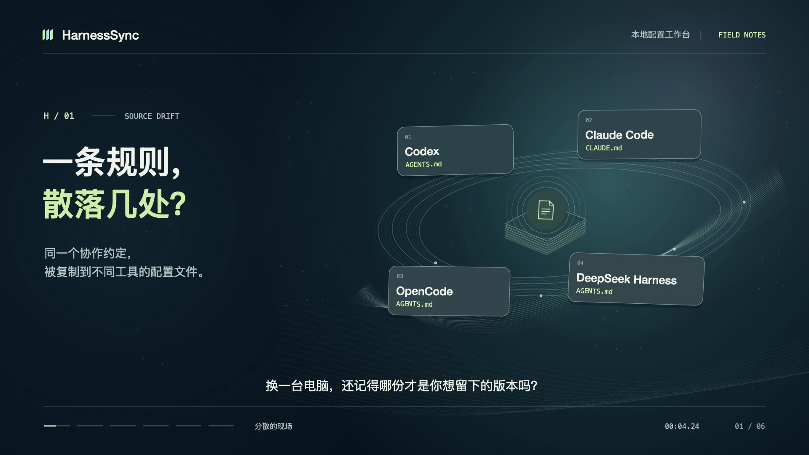
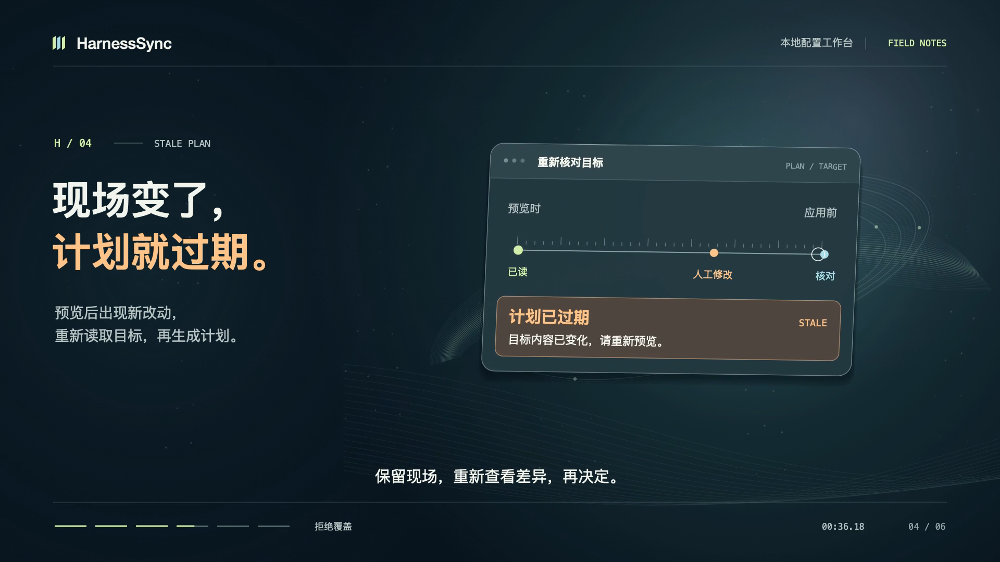
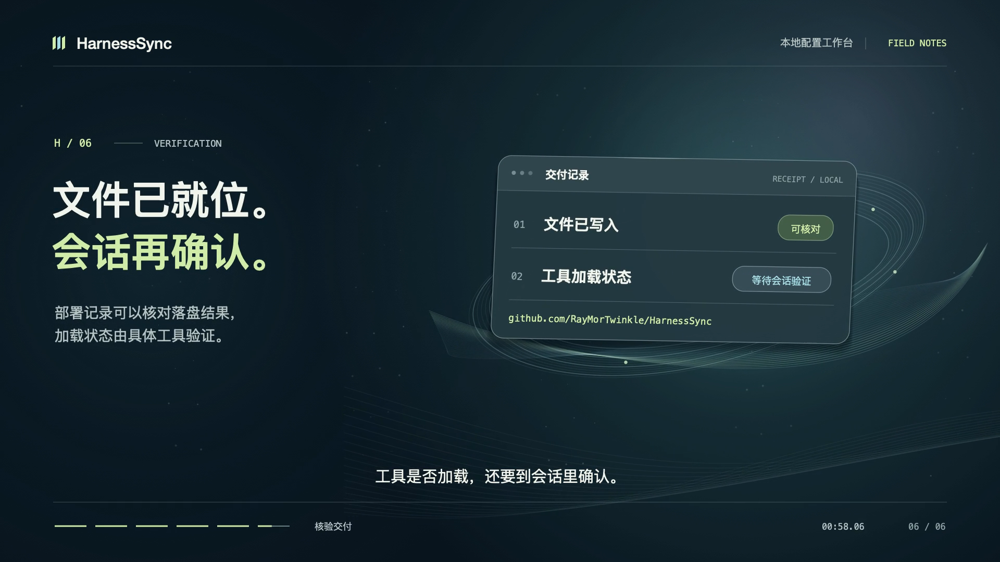
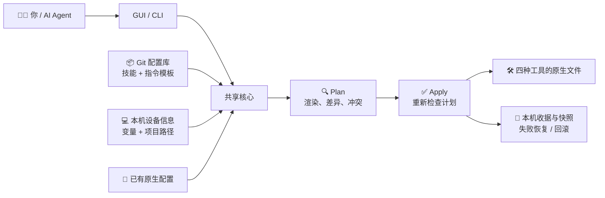

<div align="center">

# ✨ HarnessSync

### 你的 AI 搭档可以换，默契不用重写。

**把技能和指令收进一个 Git 仓库，在不同工具、不同设备之间，从容预览，再安心部署。**

[](https://nodejs.org/)
[](package.json)
[](LICENSE)
[](https://raymortwinkle.github.io/HarnessSync/)
[](https://raymortwinkle.github.io/HarnessSync/media/promo.mp4)
[](https://github.com/RayMorTwinkle/HarnessSync)

**[✨ 在线交互体验站](https://raymortwinkle.github.io/HarnessSync/) · [🎬 观看中文宣传片](https://raymortwinkle.github.io/HarnessSync/media/promo.mp4) · [🚀 3 分钟上手](#quick-start) · [📊 实测对比](#benchmarks) · [🏗️ 核心架构](#architecture)**

[](https://raymortwinkle.github.io/HarnessSync/media/promo.mp4)

**👆 点击画面观看中文宣传片** · [打开交互体验站，亲手试试 →](https://raymortwinkle.github.io/HarnessSync/)

<video src="https://raymortwinkle.github.io/HarnessSync/media/promo.mp4" controls width="800" poster="docs/media/promo-cover.jpg"></video>

<sub>如果当前页面不支持内嵌播放，请点击上方封面或<a href="https://raymortwinkle.github.io/HarnessSync/media/promo.mp4">直接打开视频</a>。</sub>

<table>
<tr>
<td align="center"><br><strong>🧩 一份配置，多工具协作</strong></td>
<td align="center"><br><strong>🔍 先看清变化，再决定写入</strong></td>
</tr>
</table>

</div>

## 💡 为什么做它？

换了一个 AI 编程工具，熟悉的规则和技能又要复制一遍；换了电脑，项目路径也跟着变。时间久了，你甚至不知道哪份配置才是最新的。😵‍💫

HarnessSync 把共享的技能和指令放进普通 Git 仓库，把设备路径留在本机。它先读取已有配置、展示部署差异，再把内容写到工具的原生位置——让你把精力留给创造，而不是整理配置。🌱

## ✨ 核心亮点

- **🧰 一处整理，四种工具使用**：支持 DeepSeek Harness、OpenCode、Codex 和 Claude Code；完整技能包的脚本、资源和执行权限都能保留。
- **🗺️ 配置跟着走，路径留在本机**：全局、设备、项目作用域各司其职；项目以稳定 ID 标识，每台设备单独绑定目录。
- **👀 先预览，再落盘**：规划时读取原生配置，展示动作、差异与冲突；应用时重新检查，拒绝过期计划。
- **🛟 有边界，也有退路**：通过收据和指纹识别托管内容，保留快照；遇到未托管同名技能、外部修改等情况时等待处理，并支持回滚。
- **🔄 用自己的 Git 仓库同步**：相同条目自动合并，不同内容并排比较；设备路径、变量和快照留在本机。
- **🤝 GUI、CLI 和 Agent 同一套核心**：在本机工作台操作，也可以用 `hsync` 和内置的 [管理技能](skills/manage-harness-sync/SKILL.md) 协作。
- **🧩 给新工具留好接口**：通过声明式 JSON 清单描述工具路径，详见[插件指南](docs/plugins.md)。

<a id="architecture"></a>
## 🏗️ 工作原理



配置库保存可移植的模板；设备身份、变量、项目目录绑定、收据和快照保存在库之外。自动部署也使用相同的规划器和安全检查；需要审查时会停止，等待你处理。

<details>
<summary><strong>安全边界与使用限制</strong></summary>

- 默认保留指令管理区块外的内容。基于已验证扫描显式登记的初始化完整替换是例外：计划展示完整差异，快照保留原件。
- 拒绝损坏的标记、过期计划和通过符号链接写入；回滚也不会覆盖部署后的新修改。工具选择不是访问控制边界，共享目录可能被其他工具读取。
- 初始化会话期间暂停自动部署；完成完整手动应用、取消会话或会话到期后恢复原设置。会话结束后，自动部署默认开启。想在每次写入前手动审查，请在编辑源配置之前运行 `hsync config set deploy.auto false`。
- 扫描覆盖已知位置，不代表工具可能读取的全部配置。文件已部署不等于运行中的 AI 会话已经加载它。自然语言指令冲突仍需人工或 AI 审查。
- 每个项目在每台设备上只绑定一个目录；整个库中的技能名必须唯一。变量会渲染到原生文件，请勿用来保存凭证。
- 技能包可能包含凭证文件；若选择同步它们，使用自己拥有的**私有**仓库。备份也可能包含这些文件，仅保存在本机。详见 [CLI 文档](docs/cli.md)和[本机设置](docs/settings.md)。

</details>

<a id="benchmarks"></a>
## 📊 实测改善：一次预览，少做多少重复工作？

在 **48 条全局规则、四个内置工具**的评测样本中，重构前后的一次部署预览：

| 方法调用次数 | 重构前 | 重构后 |
| --- | ---: | ---: |
| 读取源清单 `Store.manifest()` | **195 次** | **3 次** |
| 读取设备配置 `Store.device()` | **587 次** | **3 次** |

<details>
<summary><strong>🔬 查看实验口径与证据</strong></summary>

对比的是工作起点 `2dcab47` 与重构提交 `6476646`，每组预热一次、采样五次，五次计数一致。测试逐工具断言完整输出和创建动作，并检查预览不写入文件；设备配置变化后，新预览使用新值，旧计划被拒绝。

这些数字是方法调用次数，**不是物理磁盘访问次数，也不能换算成用户机器上的速度提升**。样本不覆盖大规模二进制技能、远端 Git 等待、多进程竞写或真实工具会话。[完整评测报告与原始记录](docs/evals/refactor-1126-report.md)

</details>

<a id="quick-start"></a>
## 🚀 3 分钟本地跑起来

需要 **Node.js 22.12+、npm 和 Git**。安装器支持 macOS 和 Linux；Windows 请使用 WSL。当前记录的真实会话验收仅覆盖 macOS，详见[本机验收](docs/local-acceptance.md)。

```sh
curl -fsSL https://raw.githubusercontent.com/RayMorTwinkle/HarnessSync/main/install.sh | bash
```

按安装提示将启动器目录加入 `PATH`，然后打开本机工作台：

```sh
hsync open
```

在初始化面板扫描已有配置，查看差异并决定如何处理。新服务需要保持终端运行；按 `Ctrl+C` 停止。也可以先[查看安装脚本](install.sh)，或使用 `~/.local/bin/hsync open` 直接运行。

想通过命令行准备管理技能并检查状态？

```sh
hsync onboard prepare --json
hsync onboard show --json
hsync doctor --json
```

<details>
<summary><strong>🧭 手动审查部署与恢复</strong></summary>

在编辑源配置前关闭自动部署，然后查看计划，使用返回的计划 ID 应用；需要回滚时使用历史记录中的部署 ID。

```sh
hsync config set deploy.auto false
hsync plan --json
hsync apply --plan PLAN_ID
hsync history
hsync rollback DEPLOYMENT_ID
```

首次扫描或实际部署前会保存本机基线。使用 `hsync backup list` 查看备份，`hsync backup restore` 先预览恢复；卸载、恢复与更多命令见 [CLI 文档](docs/cli.md)。

</details>

## 📚 延伸阅读 & 许可

- [✨ 在线交互体验站](https://raymortwinkle.github.io/HarnessSync/)：用虚构配置体验切换设备和工具，无需安装。
- [📊 重构评测报告](docs/evals/refactor-1126-report.md) · [🏗️ 架构地图](docs/architecture.md) · [⌨️ CLI 文档](docs/cli.md) · [🧩 工具插件指南](docs/plugins.md)
- [🤝 贡献指南](CONTRIBUTING.md) · [English README](README_EN.md) · [🌐 Ray 的个人主页](https://raymor.top)
- 采用 [MIT 许可证](LICENSE)。独立实现，参考 [Skills Manager](https://github.com/xingkongliang/skills-manager) 的思路。

<div align="center">

**如果它帮你找回了和 AI 搭档之间的默契，欢迎点个 ⭐ Star。**

</div>
