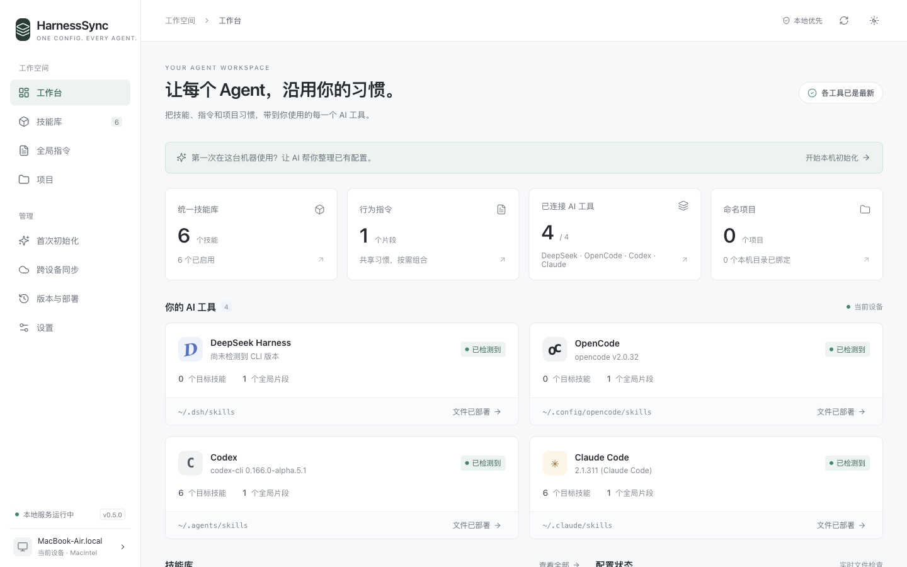
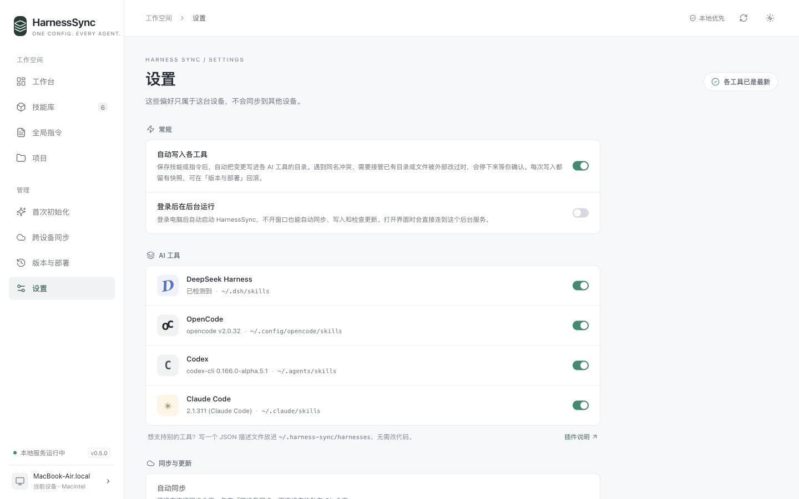

# HarnessSync

One library of skills and instructions for your AI coding tools.

HarnessSync writes shared skills and instructions into each tool's native folders. Keep the source library in your own private Git repository and sync it across devices, while device paths and deployment state stay local. A local web GUI and CLI use the same core.

[简体中文](README.zh-CN.md)



The GUI, CLI messages, and bundled skills are currently in Simplified Chinese. Contributions to internationalization are welcome.

## Features

- Unified skill library: import complete packages, including scripts, assets, and executable permissions.
- Instructions with device, project, and custom variables.
- Global, device, and per-project configuration with stable project IDs and local directory bindings.
- Automatic deployment of clean changes, with snapshots, failure recovery, and rollback.
- Conflict choices: use the library version, import the native version, or skip a target.
- Git skill sources: install packages, check upstream changes, inspect diffs, update, or detach.
- Cross-device sync through your own private Git repository: identical entries merge themselves, differing ones become side-by-side conflicts you or your Agent can resolve.
- Declarative tool plugins: add discovery paths in JSON.
- Settings page and login service for macOS and Linux with systemd user services.
- CLI ≡ GUI: both call the same core for configuration and deployment.
- AI-manageable through the bundled [`manage-harness-sync` skill](skills/manage-harness-sync/SKILL.md).

## Supported tools

Default native paths from [`harnesses/*.json`](harnesses/). The planner may choose shared skill directories to reduce duplicate copies.

| Tool             | Global skills directory     | Global instructions file                                             |
| ---------------- | --------------------------- | -------------------------------------------------------------------- |
| DeepSeek Harness | `~/.dsh/skills`             | `~/.dsh/AGENTS.md`                                                   |
| OpenCode         | `~/.config/opencode/skills` | `~/.config/opencode/AGENTS.md`                                       |
| Codex            | `~/.agents/skills`          | `~/.codex/AGENTS.md`; nonempty `AGENTS.override.md` takes precedence |
| Claude Code      | `~/.claude/skills`          | `~/.claude/CLAUDE.md`                                                |

Roots respect `DSH_HOME`, `XDG_CONFIG_HOME`, `CODEX_HOME`, and `CLAUDE_CONFIG_DIR`. DeepSeek also reads shared paths under `DSH_AGENTS_HOME` (default `~/.agents`). Codex's native skill directory remains `~/.agents/skills` when `CODEX_HOME` changes. See [plugin path semantics](docs/plugins.md#path-templates) for the full reader map.

Project skills use `.dsh/skills`, `.opencode/skills`, `.agents/skills`, and `.claude/skills`, respectively. DeepSeek, OpenCode, and Codex share project `AGENTS.md`; project instructions for one must select all enabled peers sharing that file. Claude uses `CLAUDE.md`. Tool selection is not an access-control boundary: other tools may read shared directories.

## Install

Requires Node.js **22.12+**, npm, and Git. The installer supports macOS and Linux. Use **WSL on Windows**; native Windows is not supported. Recorded real-session verification covers macOS only; see the [acceptance record](docs/local-acceptance.md) and [adapter evidence](docs/adapters.md).

```sh
curl -fsSL https://raw.githubusercontent.com/RayMorTwinkle/HarnessSync/v0.5.0/install.sh | bash
```

The installer uses `~/.local/share/harness-sync` and creates `~/.local/bin/hsync`. It needs no sudo, leaves shell configuration alone, and only installs the application. Add the launcher directory to PATH as directed, or use `~/.local/bin/hsync` directly. Re-run the installer for an upgrade; restart a running service to use the new build. Your library in `~/.harness-sync` is separate from the installation.

To inspect the installer first:

```sh
curl -fsSL https://raw.githubusercontent.com/RayMorTwinkle/HarnessSync/v0.5.0/install.sh -o install-harness-sync.sh
bash install-harness-sync.sh --help
```

The bundled [installation skill](skills/harness-sync-install/SKILL.md) can also guide an AI through installation and onboarding.

## Quick start

```sh
hsync open
```

This opens the local GUI at `http://127.0.0.1:47821`. It reuses a verified service for the same library, or starts one in the current terminal. Keep that terminal open; Ctrl+C stops a newly started service. `hsync serve` runs without opening a browser.

Use the onboarding panel, or prepare the management skill and a Chinese handoff prompt:

```sh
hsync onboard prepare --json
hsync onboard show --json
hsync doctor --json
```

Onboarding scans known tool locations and deploys only the management skill to detected tools. It preserves existing global instructions. Hand the generated prompt to your chosen tool to organize the rest of your library.

Examples for an existing skill package and project (replace the paths; use the project ID returned by `projects add`):

```sh
hsync skills import /absolute/my-skill
hsync rules add --title 'Working agreements' --file /absolute/instructions.md
hsync projects add 'My Project' --path /absolute/project
hsync skills import /absolute/project-skill --scope project --target PROJECT_ID
hsync plan --json
```

Automatic deployment is on by default, so these source edits may also write clean changes to native folders. For a workflow that requires manual review before deployment, disable it **before editing**:

```sh
hsync config set deploy.auto false
hsync plan --json
hsync apply --plan PLAN_ID
hsync history
hsync rollback DEPLOYMENT_ID
```

Use the IDs returned by `plan` and `history`. See [CLI reference](docs/cli.md) (Chinese); each command also has `--help`.

## How it works

The flow is **library → plan → apply**. Source entries and complete skill packages live in `~/.harness-sync/repo/`, a plain Git repository. Device identity, variables, project directory bindings, settings, receipts, and snapshots live outside that repository. Set `HARNESS_SYNC_HOME` or use `hsync --root /absolute/store plan` to choose another store.

The planner reads existing native files, renders instructions, and computes paths, diffs, conflicts, and a plan ID. Apply recalculates that plan under the store lock and refuses stale IDs. Skills are copied as complete packages. Ownership receipts record managed paths and fingerprints; deployments do not silently overwrite unowned skill collisions or external edits.

Instruction updates preserve content outside the managed block. The exception is an explicit onboarding replacement staged from a verified scan: it shows the full diff and saves the original in the deployment snapshot. Snapshots also support failure recovery and rollback of the latest valid deployment. Rollback refuses later edits, keeps the source library unchanged, and does not immediately redeploy it.

Automatic deployment uses the same planner, receipts, and snapshots. Related CLI/API edits, pulled changes, and scheduler startup can trigger it. It accepts absent targets for creation and owned targets without external edits for updates/removal; an explicit skip must still match its fingerprint. Plan errors, conflicts, adoptions, replacements, staged instruction replacements, unfinished recovery, and blocking notices (leftover staging directories, a changed or unreadable local import source) stop the whole attempt for review. Informational notices, such as a disabled tool keeping its files or a shared directory that other tools also read, do not. It does not choose conflict resolutions or install upstream skill updates. Read `autoDeploy` in `hsync doctor --json`; for `needs-review`, inspect a fresh plan and apply it manually after resolving blockers. Details: [settings](docs/settings.md) (Chinese).

Instructions support `{{device.name}}`, `{{device.id}}`, `{{device.home}}`, `{{project.name}}`, `{{project.path}}`, and `{{vars.KEY}}`. Missing variables block deployment; skill contents are not templated. Variables are rendered into native files, so do not use them for credentials.

## Sync

Connect your own private, dedicated Git repository. Git authentication uses your SSH setup or credential helper; keep credentials out of URLs.

```sh
hsync sync setup --url git@github.com:USER/config.git
hsync sync status --json
hsync sync now --json
```

Alternatively, `hsync sync setup --create` creates a private GitHub repository using an installed, authenticated `gh`. On another device, connect the same URL before or after onboarding; onboarding asks whether this is your first device and compares local skills with the shared library. Entries merge by object, and same-named entries with identical content on two devices become one automatically. When content differs, `hsync sync conflicts` lists each conflict with diffs and folders under `~/.harness-sync/conflicts/<id>/` (`local/`, `remote/`, `merged/`). Choose `hsync sync resolve ENTRY_ID --keep local|remote|both`, or let an Agent combine them: the listing includes a prompt that makes it explain the differences and get your agreement before writing `merged/` and running `--keep merged`. Unresolved conflicts block pushing and automatic deployment.

Every CLI command attaches `reminders` (sync conflicts, paused deployments, skill updates, sync failures) so an Agent that calls `hsync` learns about them; turn this off with `hsync config set notices.cli false`.

After setup, automatic sync defaults to pushing after 120 seconds without edits and pulling every 10 minutes. It runs while `hsync open`, `hsync serve`, or `hsync sync watch` is running. Pulled changes can deploy automatically when `deploy.auto` is enabled and the entire plan is clean. Device paths, variables, snapshots, local plugins, and settings do not sync.

Git skills are a separate source mechanism:

```sh
hsync skills install owner/repo --skill research
hsync skills updates
hsync skills diff research
hsync skills update research
hsync skills detach research
```

Replace the repository and skill name. Background checks report available updates; installation requires an explicit update. Local library edits block an upstream update unless explicitly overridden. Install/update source edits follow the automatic deployment setting.

## Adding a tool

Add a JSON manifest in the directory printed by `hsync harness dir`, validate it with `hsync harness validate /absolute/tool.json`, then inspect a deployment plan. Built-in contributions go in `harnesses/`. Follow the [plugin guide](docs/plugins.md) for fields, discovery evidence, testing, and shared-directory behavior.

Each device can turn tools on or off in Settings. A disabled tool keeps its files as they are.



## Safety model

- Read native configuration before planning. Check ownership and fingerprints before writing or removing managed content.
- Reject malformed instruction markers, stale plans, and writes through symlinks. Explicit adoption/replacement can replace a final symlink with a copy, preserving the original link in a snapshot; it never writes through the link.
- Keep deployment snapshots locally. Refuse rollback that would overwrite newer edits.
- Serve HTTP only on `127.0.0.1`, with Host, Origin, and session-token checks.
- Report filesystem state honestly. `doctor` and the GUI cannot prove a running tool session loaded the deployed configuration.

Current limits: one local directory per project per device; unique skill names across the library; no desktop installer. Scans cover known locations, not all configuration a tool might load. Natural-language instruction conflicts require human or AI review.

## Development

```sh
git clone https://github.com/RayMorTwinkle/HarnessSync.git
cd HarnessSync
npm ci
npm run build
```

Use a fake HOME and store for local CLI/GUI work:

```sh
sandbox=$(mktemp -d)
mkdir -p "$sandbox/home" "$sandbox/store"
env -u DSH_HOME -u DSH_AGENTS_HOME -u CODEX_HOME -u CLAUDE_CONFIG_DIR -u XDG_CONFIG_HOME \
  HOME="$sandbox/home" HARNESS_SYNC_HOME="$sandbox/store" npm run dev
```

Ctrl+C stops the development server. Use the same isolation for CLI commands (`npm run cli -- plan --json`), built CLI/GUI (`npm start`), and tests. `npm run typecheck` checks types; `npm test` runs the full suite; `npm run build` checks types and builds CLI/UI. See [CONTRIBUTING.md](CONTRIBUTING.md) for targeted tests and the reusable sandbox helper. Core changes require both the full suite and build.

## Contributing

Start with [CONTRIBUTING.md](CONTRIBUTING.md) and the [architecture map](docs/architecture.md). Tool plugins, documentation, internationalization, tests, and UI improvements are welcome. Detailed operational docs are currently mostly Chinese.

Independent implementation, informed by [Skills Manager](https://github.com/xingkongliang/skills-manager).

License: [MIT](LICENSE).
