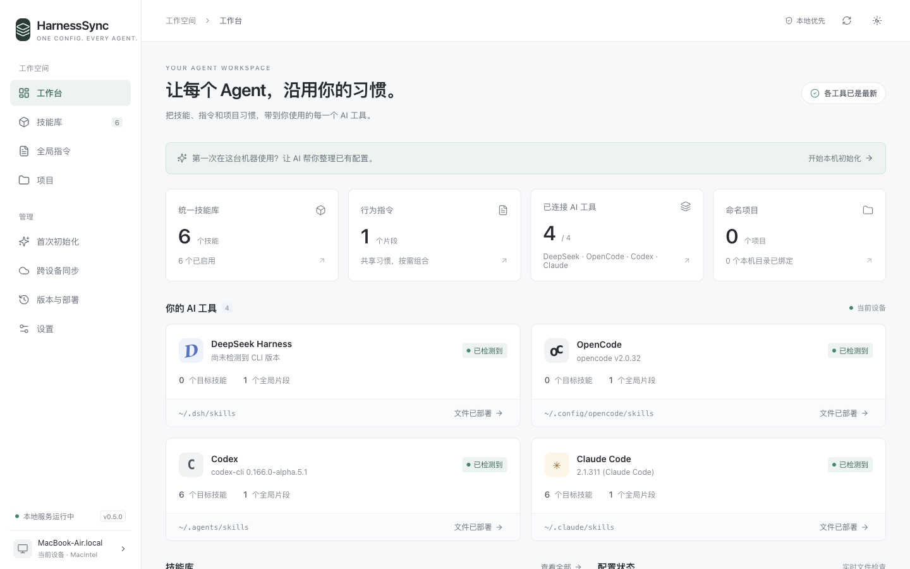
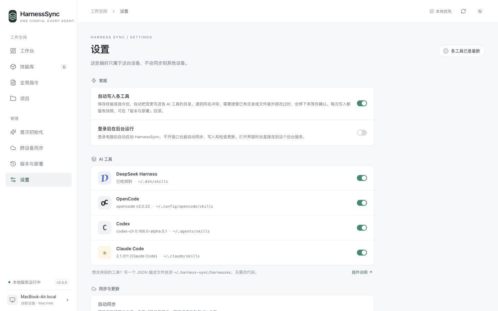

# HarnessSync

在一个库中管理 AI 编程工具的技能和指令。

HarnessSync 把共享技能和指令写入各工具的原生目录。源配置保存在你自己的私有 Git 仓库中，可以跨设备同步；设备路径和部署状态留在本机。本机 Web GUI 和 CLI 使用同一套核心。

[English](README.md)



GUI、CLI 提示和内置技能目前使用简体中文，欢迎参与国际化。

## 功能

- 统一技能库：导入完整包，保留脚本、资源和执行权限。
- 指令支持设备变量、项目变量和自定义变量。
- 全局、设备和项目作用域；项目使用稳定 ID，目录由各设备单独绑定。
- 自动部署干净变更，保留快照，支持失败恢复和回滚。
- 同名冲突逐项选择：使用库版本、原生版本收库或跳过目标。
- Git 技能来源：安装、检查上游变化、查看差异、更新或脱离上游。
- 通过自己的私有 Git 仓库跨设备同步：相同条目自动合并，不同的并排对比，由你或你的 Agent 处理。
- 声明式工具插件：用 JSON 描述发现路径即可添加工具。
- 设置页及登录启动服务，支持 macOS 和具有 systemd 用户服务的 Linux。
- CLI ≡ GUI：配置和部署均调用同一套核心。
- 内置 [`manage-harness-sync` 管理技能](skills/manage-harness-sync/SKILL.md)，可交给 AI 管理配置。

## 支持的工具

下表来自 [`harnesses/*.json`](harnesses/)，列出默认原生路径。规划器可能选择共享技能目录以减少重复副本。

| 工具             | 全局技能目录                | 全局指令文件                                         |
| ---------------- | --------------------------- | ---------------------------------------------------- |
| DeepSeek Harness | `~/.dsh/skills`             | `~/.dsh/AGENTS.md`                                   |
| OpenCode         | `~/.config/opencode/skills` | `~/.config/opencode/AGENTS.md`                       |
| Codex            | `~/.agents/skills`          | `~/.codex/AGENTS.md`；非空 `AGENTS.override.md` 优先 |
| Claude Code      | `~/.claude/skills`          | `~/.claude/CLAUDE.md`                                |

根目录遵循 `DSH_HOME`、`XDG_CONFIG_HOME`、`CODEX_HOME`、`CLAUDE_CONFIG_DIR`。DeepSeek 还读取 `DSH_AGENTS_HOME` 下的共享路径，默认 `~/.agents`。修改 `CODEX_HOME` 不会改变 Codex 的原生技能目录 `~/.agents/skills`。完整 reader map 见[插件路径语义](docs/plugins.md#path-templates)。

项目技能依次使用 `.dsh/skills`、`.opencode/skills`、`.agents/skills`、`.claude/skills`。DeepSeek、OpenCode、Codex 共用项目 `AGENTS.md`；面向其中之一的项目指令必须同时选择共用该文件的所有已启用工具。Claude 使用 `CLAUDE.md`。工具选择不是访问控制边界，其他工具仍可能读取共享目录。

## 安装

需要 Node.js **22.12+**、npm、Git。安装器支持 macOS 和 Linux；**Windows 请使用 WSL**，不支持原生 Windows。目前有记录的真实会话验收仅覆盖 macOS，见[本机验收](docs/local-acceptance.md)和[适配证据](docs/adapters.md)。

```sh
curl -fsSL https://raw.githubusercontent.com/RayMorTwinkle/HarnessSync/v0.5.0/install.sh | bash
```

默认安装到 `~/.local/share/harness-sync`，启动器为 `~/.local/bin/hsync`。无需 sudo，不修改 shell 配置，只安装程序。按提示把启动器目录加入 PATH，或直接运行 `~/.local/bin/hsync`。升级时重新运行安装器；已有服务需重启才能使用新构建。配置库 `~/.harness-sync` 与程序安装目录分开保存。

也可以先查看脚本：

```sh
curl -fsSL https://raw.githubusercontent.com/RayMorTwinkle/HarnessSync/v0.5.0/install.sh -o install-harness-sync.sh
bash install-harness-sync.sh --help
```

内置[安装技能](skills/harness-sync-install/SKILL.md)也可指导 AI 安装和初始化。

## 快速开始

```sh
hsync open
```

默认打开 `http://127.0.0.1:47821`。同库已有经过身份核验的服务时直接复用，否则在当前终端启动；新服务需保持终端运行，Ctrl+C 停止。`hsync serve` 只启动服务，不打开浏览器。

在 GUI 使用初始化面板，或运行以下命令准备管理技能和中文交接提示词：

```sh
hsync onboard prepare --json
hsync onboard show --json
hsync doctor --json
```

初始化扫描已知工具位置，只向检测到的工具部署管理技能，保留原有全局指令。把生成的提示词交给所选工具，继续整理其余技能与指令。

已有技能包与项目的操作示例（替换路径，使用 `projects add` 返回的项目 ID）：

```sh
hsync skills import /absolute/my-skill
hsync rules add --title 'Working agreements' --file /absolute/instructions.md
hsync projects add 'My Project' --path /absolute/project
hsync skills import /absolute/project-skill --scope project --target PROJECT_ID
hsync plan --json
```

自动部署默认开启，上述源编辑可能同时把干净变更写入原生目录。如需每次部署前手动审查，请在**编辑之前**关闭：

```sh
hsync config set deploy.auto false
hsync plan --json
hsync apply --plan PLAN_ID
hsync history
hsync rollback DEPLOYMENT_ID
```

使用 `plan` 和 `history` 返回的 ID。完整命令见 [CLI 文档](docs/cli.md)，各命令也提供 `--help`。

## 工作原理

流程为 **配置库 → plan → apply**。源条目和完整技能包保存在 `~/.harness-sync/repo/`，这是普通 Git 仓库。设备身份、变量、项目目录绑定、设置、收据和快照保存在仓库之外。可用 `HARNESS_SYNC_HOME` 或 `hsync --root /absolute/store plan` 指定其他配置库根目录。

规划器读取已有原生文件、渲染指令，计算路径、差异、冲突和计划 ID。应用时持有配置库锁并重新计算，拒绝过期 ID。技能按完整包复制；所有权收据记录托管路径与指纹，不会静默覆盖未托管的同名技能或外部修改。

指令更新保留管理区块外的内容。例外是基于已验证扫描显式登记的初始化完整替换：计划展示完整差异，部署快照保留原件。快照也用于失败恢复和最近一次有效部署的回滚。回滚拒绝覆盖部署后的新修改，不改变源库，也不会立即重新部署。

自动部署使用相同的规划器、收据和快照。相关 CLI/API 编辑、同步拉取和调度器启动都可能触发。它允许在不存在的目标上新建，以及更新或撤下未被外部修改的已托管内容；显式跳过选择必须仍匹配原生指纹。计划错误、冲突、接管、覆盖、初始化指令替换登记、未完成恢复，以及需要确认的提示（暂存残留、本机导入源已变化或无法读取）会停止整次自动部署，等待审查。仅供参考的提示不会阻止，例如某个工具已停用、文件保持原样，或共享目录也会被其他工具读取。它不代选冲突方案，也不自动安装上游技能更新。读取 `hsync doctor --json` 的 `autoDeploy`；出现 `needs-review` 时检查新计划，解决阻碍后手动应用。详见[本机设置](docs/settings.md)。

指令支持 `{{device.name}}`、`{{device.id}}`、`{{device.home}}`、`{{project.name}}`、`{{project.path}}`、`{{vars.KEY}}`。缺少变量阻止部署，技能正文不做模板替换。变量会渲染到原生文件中，不要用来保存凭证。

## 同步

连接自己拥有的私有专用 Git 仓库。认证由 SSH 或 Git 凭证助手管理，不要把凭证放进 URL。

```sh
hsync sync setup --url git@github.com:USER/config.git
hsync sync status --json
hsync sync now --json
```

也可以用 `hsync sync setup --create`，通过已安装并登录的 `gh` 创建私有 GitHub 仓库。新设备在初始化之前或之后连接同一 URL 都可以；初始化会先问这是不是你的第一台设备，再把本机技能和共享库逐个比较。源配置按对象合并，两台设备上同名且内容相同的条目自动合成一份。内容不同时，`hsync sync conflicts` 列出每个冲突的差异，文件放在 `~/.harness-sync/conflicts/<id>/`（`local/`、`remote/`、`merged/`）。可以用 `hsync sync resolve ENTRY_ID --keep local|remote|both` 选择，也可以交给 Agent 合并：列表里附带的提示词要求它先说明差异、得到你同意，才写入 `merged/` 并执行 `--keep merged`。未解决冲突阻止推送和自动部署。

每个 CLI 命令都会附带 `reminders`（同步冲突、暂停的部署、技能更新、同步失败），调用 `hsync` 的 Agent 因此能及时知道；用 `hsync config set notices.cli false` 关闭。

连接成功后，自动同步默认在停止编辑 120 秒后推送，每 10 分钟拉取一次；需要 `hsync open`、`hsync serve` 或 `hsync sync watch` 持续运行。开启 `deploy.auto` 且完整计划干净时，拉取的变更可自动部署。设备路径、变量、快照、本机插件和设置不参与同步。

Git 技能是另一种来源机制：

```sh
hsync skills install owner/repo --skill research
hsync skills updates
hsync skills diff research
hsync skills update research
hsync skills detach research
```

替换仓库和技能名。后台检查只提示更新，安装需显式执行 update。本地库版本有修改时拒绝上游更新，除非显式覆盖。安装和更新源库后遵循自动部署设置。

## 添加工具

在 `hsync harness dir` 打印的目录中放入 JSON 清单，用 `hsync harness validate /absolute/tool.json` 校验，再检查部署计划。内置工具贡献放入 `harnesses/`。字段、发现证据、测试和共享目录行为见[插件指南](docs/plugins.md)。

每台设备都可以在「设置」里单独开关工具。停用的工具已有文件保持原样。



## 安全模型

- 规划前读取原生配置；写入或撤下托管内容前核对所有权与指纹。
- 拒绝损坏的指令标记、过期计划和通过符号链接写入。显式接管或覆盖可把末级链接替换为副本，快照保留原链接；始终不写入链接目标。
- 快照只存本机；回滚拒绝覆盖后续新修改。
- HTTP 仅监听 `127.0.0.1`，检查 Host、Origin 和会话 token。
- 如实报告文件系统状态；`doctor` 和 GUI 不能证明运行中的工具会话已加载部署结果。

当前限制：每个项目每台设备只绑定一个目录；整个库中的技能名必须唯一；没有桌面安装包。扫描覆盖已知位置，不代表工具可能加载的全部配置。自然语言指令冲突需人工或 AI 审查。

## 开发

```sh
git clone https://github.com/RayMorTwinkle/HarnessSync.git
cd HarnessSync
npm ci
npm run build
```

本地 CLI/GUI 开发使用临时 HOME 和配置库：

```sh
sandbox=$(mktemp -d)
mkdir -p "$sandbox/home" "$sandbox/store"
env -u DSH_HOME -u DSH_AGENTS_HOME -u CODEX_HOME -u CLAUDE_CONFIG_DIR -u XDG_CONFIG_HOME \
  HOME="$sandbox/home" HARNESS_SYNC_HOME="$sandbox/store" npm run dev
```

Ctrl+C 停止开发服务。CLI（`npm run cli -- plan --json`）、构建后的 CLI/GUI（`npm start`）和测试也应使用相同隔离。`npm run typecheck` 检查类型；`npm test` 运行完整测试；`npm run build` 检查类型并构建 CLI/UI。定向测试和可复用的沙箱函数见 [CONTRIBUTING.md](CONTRIBUTING.md)。核心改动必须通过完整测试与构建。

## 参与贡献

从[贡献指南](CONTRIBUTING.md)和[架构地图](docs/architecture.md)开始。欢迎工具插件、文档、国际化、测试和 UI 改进。目前详细操作文档多数为中文。

独立实现，参考 [Skills Manager](https://github.com/xingkongliang/skills-manager) 的思路。

许可证：[MIT](LICENSE)。
