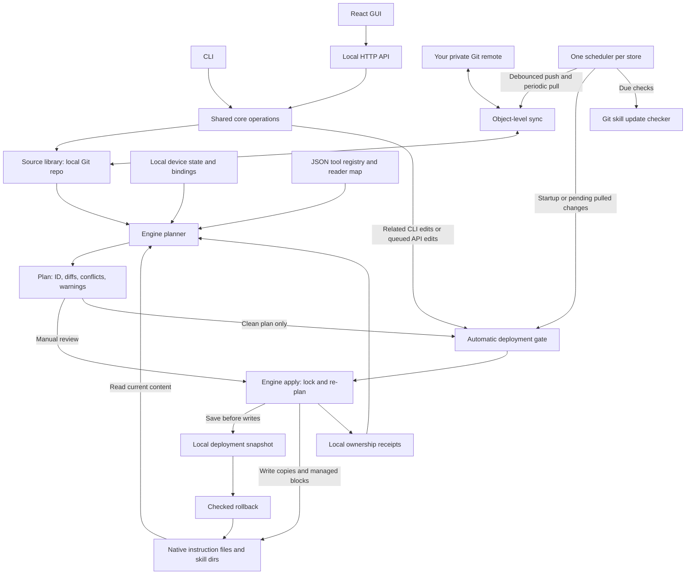

# Architecture

HarnessSync separates a portable source library from device-specific state and native tool files. The CLI and local HTTP server call the same core. React renders that state and requests operations over HTTP; it does not mutate files.

Read [AGENTS.md](../AGENTS.md) for required invariants and [CONTEXT.md](../CONTEXT.md) for the domain vocabulary and implementation decisions (Chinese). Examples here describe the current checkout; they do not establish that a running tool session loaded deployed files.

## Data flow

The sync layer updates source data. The CLI or background scheduler then attempts automatic deployment according to local settings. Update checks report upstream skill changes; they do not install them. Auto-deployment uses the same `Engine.plan()` and `Engine.apply()` as manual deployment.

## Module map

### Store and source layout

[`src/core/store.ts`](../src/core/store.ts) owns library initialization, validated source mutations, device data, project bindings, optimistic revisions, local Git commits, and the cross-process store lock. [`layout.ts`](../src/core/layout.ts) reads the legacy v1 manifest and current v2 entry files; writes use the v2 layout. Existing initialized stores can be opened read-only without creating a lock. Actual mutations take a lock and validate their inputs/revision. The store delegates source restore to the sync transaction/recovery code.

### Deployment engine

[`src/core/engine.ts`](../src/core/engine.ts) renders scoped instructions, resolves variables, reads native state, plans diffs, handles conflict choices, and applies or rolls back deployments. It combines library entries, local bindings, registry data, and ownership receipts. [`files.ts`](../src/core/files.ts) provides package validation, fingerprints, atomic writes, staging, and symlink checks; [`native-snapshot.ts`](../src/core/native-snapshot.ts) preserves native trees for explicit replacement and restoration. [`scanner.ts`](../src/core/scanner.ts) performs read-only discovery, and [`onboarding.ts`](../src/core/onboarding.ts) records scans, bootstraps only the management skill, and stages explicit instruction replacement.

### Harness registry

[`src/core/harness-registry.ts`](../src/core/harness-registry.ts) discovers built-in JSON manifests in `harnesses/` and local ones in `<store>/harnesses/`. It rejects invalid/duplicate manifests, resolves path templates and environment overrides, and caches by directory listing and file metadata. [`src/shared/harness-manifest.ts`](../src/shared/harness-manifest.ts) defines the strict format. Registry changes participate in the source revision so an old plan cannot survive a tool/path change. Local plugin files and disabled-tool choices do not sync.

### Adapters and placement

[`src/core/adapters.ts`](../src/core/adapters.ts) derives native/project targets and shared-instruction peers from the registry. It unions skill readers by directory and chooses placement covering the selected enabled tools. Its exact search minimizes duplicate visibility, extra unselected readers, legacy directories, then copy count. It also probes locally installed tool versions using restricted commands. Manifests supply discovery data, not executable deployment code. Shared reader paths mean tool selection cannot guarantee runtime visibility isolation. Details are in [plugins.md](plugins.md).

### Sync

[`src/core/sync.ts`](../src/core/sync.ts) connects a user-owned Git remote, fetches/pushes, and merges rules, projects, and skill metadata/packages as objects using a common ancestor. It records conflicts locally, prevents pushing unresolved conflicts, and implements source restore, resolution, undo, and interrupted-operation recovery. Local safety points and recovery journals protect source operations. Sync changes the library; it does not directly write native directories. Device-scoped source entries travel with the library, while device identity, variables, and path bindings do not.

### Background scheduler

[`src/core/sync-scheduler.ts`](../src/core/sync-scheduler.ts) supplies the lifecycle shared by `serve`, a new `open` server, and `sync watch`. A local PID/token ownership record permits one scheduler per store. Polling runs sync ticks, queues deployment at startup or after pulls, retries stale automatic plans, and schedules update checks. Close cancels timers and waits for in-flight work. [`update-checks.ts`](../src/core/update-checks.ts) handles skill-check cadence, cached results, and retry backoff without installing updates.

### Automatic deployment

[`src/core/auto-deploy.ts`](../src/core/auto-deploy.ts) defaults to enabled through Settings. It gates a full engine plan, applies clean changes, and records the latest local outcome as `applied`, `nothing`, `needs-review`, `failed`, or `disabled`. Existing unchanged/skipped entries, absent creates, and unedited owned updates/removals can pass. Plan errors, adoption, replacement, staged instruction replacement, unresolved sync conflicts, incomplete recovery, and plan notices marked `blocking` stop the entire attempt; informational notices (`blocking: false`) do not. Each `PlanNotice` code must declare which it is. Policy and blockers are rechecked under the apply lock. API requests are debounced; related CLI mutations attempt deployment before returning. Rollback is not an automatic redeployment trigger.

### Settings

[`src/core/settings.ts`](../src/core/settings.ts) validates local settings and exposes the same facade to CLI and HTTP. `settings.json` stores deployment/update preferences; sync preferences reuse `sync-auto.json`. Login preference is derived from actual OS service state rather than a separate stored switch. Settings revisions guard concurrent patches. Preferences, scheduler state, update caches, and automatic-deployment outcomes all live outside the source Git repository. See [settings.md](settings.md) for the API and defaults (Chinese).

### Login service

[`src/core/service.ts`](../src/core/service.ts) manages a macOS LaunchAgent or Linux systemd user service with an injectable command runner. It checks service-file ownership, rejects symlinks/foreign files, and uses absolute Node and built CLI paths. A source `tsx` invocation cannot install a service. The service runs `serve --background`, with logs in `<store>/logs/service.log` and size-based rotation. It is a login-started process, not a separate sync or deployment implementation. Tests replace OS commands with a fake runner.

### Git skill sources

[`src/core/git-skills.ts`](../src/core/git-skills.ts) discovers and installs complete skill packages from Git repositories, records upstream URL/ref/subpath/commit and fingerprints, checks upstream commits/trees, produces diffs, updates, and detaches sources. It bounds Git concurrency and temporary downloads, preserves scope and metadata, and refuses local edits on update unless explicitly overridden. Source records sync; download/check caches do not. [`skill-sources.ts`](../src/core/skill-sources.ts) separately tracks local development origins and refreshes packages from them; those absolute origin paths stay local.

### HTTP server

[`src/server.ts`](../src/server.ts) serves the UI and JSON API on `127.0.0.1`. It checks Host, Origin, session tokens, JSON request bodies, and sizes before dispatching operations to the core. It owns the background scheduler lifecycle and queues related source mutations for automatic deployment. The response's `autoDeployQueued` flag means work was queued, not that native files were written; clients read the eventual outcome. [`src/web-ui.ts`](../src/web-ui.ts) verifies an existing same-store service before reusing it and opens the browser.

### CLI

[`src/cli.ts`](../src/cli.ts) defines Commander commands, scope options, JSON output, and error exit codes. It calls the same Store, Engine, Sync, Settings, and service modules as HTTP, with automatic-deployment hooks for related mutations. Command definitions are the source of truth for examples; not every core operation needs a distinct CLI command. See [cli.md](cli.md) for the full command reference (Chinese).

### UI

[`src/ui/`](../src/ui/) contains React pages, editors, onboarding, conflict choices, plan previews, and history. [`lib.ts`](../src/ui/lib.ts) supplies the HTTP client and API types, [`app-context.tsx`](../src/ui/app-context.tsx) shares application state, and [`pages/Settings.tsx`](../src/ui/pages/Settings.tsx) edits local deployment, startup, sync, tool, and appearance preferences. Use registry-provided tool names and metadata with fallbacks for new IDs. UI text currently uses Simplified Chinese. The UI requests core operations through HTTP and displays their results.

## Plan, receipt, and snapshot model

A **plan** is a fresh calculation, not a persisted permission to overwrite a path. Its SHA-256 ID includes the store revision, native before/after fingerprints, statuses, conflict choices, staging state, errors, and warnings. The revision covers source entries, skill packages, device state, deployment state, and registry metadata. Apply takes the same cross-process Store lock as other mutations, recalculates the plan, and rejects a mismatching ID. It also rechecks targets before writes. A changed source, target, binding, manifest, or choice requires a new plan.

A **receipt** in `<store>/state.json` records a managed path, kind, tool, source/project identity, and content fingerprint. For instructions, ownership tracks the managed block; ordinary updates preserve surrounding text. For skills, it tracks the package. Receipts allow safe updates and removal of owned content. Matching unowned content can produce an `adopt` plan that only records ownership; differing unowned content requires an explicit choice. Disabling/removing a tool preserves its unwanted owned paths, while a shared path still needed by an enabled tool remains managed.

A **deployment snapshot** in `<store>/deployments/<id>.json` records before-state receipts and native content before writes, including relevant file modes and explicit-replacement trees/links. Its lifecycle is `pending` → `applied` or `failed`, with `rolled-back` for a successful rollback. Apply attempts restoration on failure. An interrupted pending deployment blocks new deployment and requires recovery through rollback. Rollback proceeds from the latest valid deployment and refuses native edits made since it. It changes native files and receipts, leaving the source library alone.

Snapshots are local recovery records, not complete filesystem backups. Snapshot size and retention are bounded; ACLs, extended attributes, ownership, timestamps, and hard-link relationships are not preserved. See [conflicts.md](conflicts.md) for replacement/retention details (Chinese). Source Git history and sync safety journals are a separate recovery mechanism: source restore may trigger a new clean deployment, whereas deployment rollback does not immediately reapply source.

## Where to start

| Contribution                             | Start reading                                                                                           | Relevant tests                                                                  |
| ---------------------------------------- | ------------------------------------------------------------------------------------------------------- | ------------------------------------------------------------------------------- |
| Add a coding tool                        | `harnesses/*.json`, `harness-registry.ts`, `src/shared/harness-manifest.ts`, [plugin guide](plugins.md) | `plugins.test.ts`, `deployment.test.ts`, `onboarding.test.ts`                   |
| Change instructions or variables         | `Engine.render`, `Engine.instructions`, `Engine.plan`, `Store.saveRule`                                 | `core.test.ts`, `deployment.test.ts`                                            |
| Fix ownership, collisions, or rollback   | `Engine.plan/apply/rollback`, `files.ts`, `native-snapshot.ts`                                          | `conflicts.test.ts`, `deployment.test.ts`                                       |
| Work on settings or automatic deployment | `settings.ts`, `auto-deploy.ts`, `sync-scheduler.ts`, `src/cli.ts`, `src/server.ts`                     | `settings.test.ts`, `auto-deploy.test.ts`                                       |
| Work on login startup                    | `service.ts`, `tests/settings-helpers.ts`                                                               | `service.test.ts`                                                               |
| Change sync/undo behavior                | `sync.ts`, `layout.ts`, `sync-scheduler.ts`                                                             | `sync.test.ts`                                                                  |
| Change Git skill installation            | `git-skills.ts`, `update-checks.ts`                                                                     | `git-skills.test.ts`                                                            |
| Improve GUI or language support          | `src/ui/main.tsx`, `src/ui/app-context.tsx`, `src/ui/lib.ts`, `src/ui/pages/`, `src/cli.ts`             | `web-ui.test.ts` for server/browser-opening behavior; manual isolated UI checks |

Paths in the last table are relative to `src/core/` unless qualified; test names are under `tests/`. See [CONTRIBUTING.md](../CONTRIBUTING.md#use-a-fake-home) before running anything against native paths.
